<picture>
  <source media="(prefers-color-scheme: dark)" srcset="assets/hero-dark.svg">
  
</picture>

  
  
  

I am a Machine Learning Engineer at **PERFACCT** in Potsdam.
I take LLM and ML systems from a notebook to production: self-hosted inference, RAG, agentic workflows, evaluation, and deployment.
Before that I built computer vision for industrial and clinical inspection.

### Impact

| Result | How |
|:--|:--|
| **3x** faster LLM inference, **~2x** lower cost | A modular serving layer over SGLang, vLLM, and Ollama. |
| **50%** fewer hallucinated tool calls | An agentic ERP assistant: LangGraph, FastAPI, Pydantic-validated tools, Langfuse evals. |
| **95%** recall on rare defects | Cocoa-defect inspection on heavily imbalanced data, in industrial pilots. |
| **3x** runtime gain | Eight inference frameworks benchmarked on NVIDIA GPUs; TensorRT won on throughput per watt. |
| **3-5x** faster data loading | Batched PostgreSQL writes and a tuned Python compute engine on a cloud platform. |

### Stack

<table>
<tr><td><b>LLM inference</b></td><td><picture><source media="(prefers-color-scheme: dark)" srcset="https://cdn.simpleicons.org/nvidia/d1d9e0"></picture>&nbsp;TensorRT &nbsp; vLLM &nbsp; SGLang &nbsp; <picture><source media="(prefers-color-scheme: dark)" srcset="https://cdn.simpleicons.org/ollama/d1d9e0"></picture>&nbsp;Ollama &nbsp; <picture><source media="(prefers-color-scheme: dark)" srcset="https://cdn.simpleicons.org/onnx/d1d9e0"></picture>&nbsp;ONNX Runtime</td></tr>
<tr><td><b>Agents and RAG</b></td><td><picture><source media="(prefers-color-scheme: dark)" srcset="https://cdn.simpleicons.org/langchain/d1d9e0"></picture>&nbsp;LangGraph &nbsp; <picture><source media="(prefers-color-scheme: dark)" srcset="https://cdn.simpleicons.org/pydantic/d1d9e0"></picture>&nbsp;Pydantic &nbsp; LlamaIndex &nbsp; <picture><source media="(prefers-color-scheme: dark)" srcset="https://cdn.simpleicons.org/qdrant/d1d9e0"></picture>&nbsp;Qdrant &nbsp; <picture><source media="(prefers-color-scheme: dark)" srcset="https://cdn.simpleicons.org/huggingface/d1d9e0"></picture>&nbsp;Transformers &nbsp; Langfuse &nbsp; <picture><source media="(prefers-color-scheme: dark)" srcset="https://cdn.simpleicons.org/modelcontextprotocol/d1d9e0"></picture>&nbsp;MCP</td></tr>
<tr><td><b>ML and vision</b></td><td><picture><source media="(prefers-color-scheme: dark)" srcset="https://cdn.simpleicons.org/pytorch/d1d9e0"></picture>&nbsp;PyTorch &nbsp; <picture><source media="(prefers-color-scheme: dark)" srcset="https://cdn.simpleicons.org/tensorflow/d1d9e0"></picture>&nbsp;TensorFlow &nbsp; <picture><source media="(prefers-color-scheme: dark)" srcset="https://cdn.simpleicons.org/scikitlearn/d1d9e0"></picture>&nbsp;scikit-learn &nbsp; <picture><source media="(prefers-color-scheme: dark)" srcset="https://cdn.simpleicons.org/opencv/d1d9e0"></picture>&nbsp;OpenCV &nbsp; YOLO &nbsp; FiftyOne</td></tr>
<tr><td><b>MLOps and cloud</b></td><td><picture><source media="(prefers-color-scheme: dark)" srcset="https://cdn.simpleicons.org/docker/d1d9e0"></picture>&nbsp;Docker &nbsp; <picture><source media="(prefers-color-scheme: dark)" srcset="https://cdn.simpleicons.org/gitlab/d1d9e0"></picture>&nbsp;GitLab CI &nbsp; <picture><source media="(prefers-color-scheme: dark)" srcset="https://cdn.simpleicons.org/mlflow/d1d9e0"></picture>&nbsp;MLflow &nbsp; <picture><source media="(prefers-color-scheme: dark)" srcset="https://cdn.simpleicons.org/dvc/d1d9e0"></picture>&nbsp;DVC &nbsp; <picture><source media="(prefers-color-scheme: dark)" srcset="https://cdn.simpleicons.org/apacheairflow/d1d9e0"></picture>&nbsp;Airflow &nbsp; <picture><source media="(prefers-color-scheme: dark)" srcset="https://cdn.simpleicons.org/opentofu/d1d9e0"></picture>&nbsp;OpenTofu &nbsp; <picture><source media="(prefers-color-scheme: dark)" srcset="https://cdn.simpleicons.org/googlecloud/d1d9e0"></picture>&nbsp;GCP</td></tr>
<tr><td><b>Backend and data</b></td><td><picture><source media="(prefers-color-scheme: dark)" srcset="https://cdn.simpleicons.org/python/d1d9e0"></picture>&nbsp;Python &nbsp; <picture><source media="(prefers-color-scheme: dark)" srcset="https://cdn.simpleicons.org/fastapi/d1d9e0"></picture>&nbsp;FastAPI &nbsp; <picture><source media="(prefers-color-scheme: dark)" srcset="https://cdn.simpleicons.org/postgresql/d1d9e0"></picture>&nbsp;PostgreSQL &nbsp; <picture><source media="(prefers-color-scheme: dark)" srcset="https://cdn.simpleicons.org/sqlalchemy/d1d9e0"></picture>&nbsp;SQLAlchemy &nbsp; <picture><source media="(prefers-color-scheme: dark)" srcset="https://cdn.simpleicons.org/linux/d1d9e0"></picture>&nbsp;Linux</td></tr>
</table>

### Selected work

<table>
<tr><td width="50%" valign="top"><a href="https://github.com/Yuvraj-Dhepe/dcase2023-audio-retrieval"><b>Audio retrieval</b></a> MSc thesis. Language-based audio retrieval on Clotho (DCASE) with synthetic data and contrastive learning.  <code>PyTorch</code> <code>contrastive</code> <code>audio</code></td><td width="50%" valign="top"><a href="https://github.com/Yuvraj-Dhepe/ddlm"><b>ddlm</b></a> A masked diffusion language model trained from scratch on TinyStories; it writes by denoising the whole sequence in parallel.  <code>diffusion</code> <code>transformers</code> <code>LM</code></td></tr>
<tr><td width="50%" valign="top"><a href="https://github.com/Yuvraj-Dhepe/llm-auditor"><b>llm-auditor</b></a> Crawls a site with Playwright and packages screenshots, accessibility trees, and network data for vision LLMs.  <code>VLM</code> <code>Playwright</code> <code>evals</code></td><td width="50%" valign="top"><a href="https://github.com/Yuvraj-Dhepe/hackhpi2025-tone-down"><b>ToneDown</b></a> HackHPI 2025. Personalized tinnitus interventions from Bayesian hierarchical models, in a mobile app.  <code>Bayesian</code> <code>Flask</code> <code>Expo</code></td></tr>
<tr><td width="50%" valign="top"><a href="https://github.com/Yuvraj-Dhepe/cotton_weed_kaggle_3lc"><b>Cotton weed detection</b></a> YOLOv8n weed detection for the Kaggle Cotton-Weed Detection Challenge, with 3LC data tracking and hyperparameter tuning.  <code>YOLO</code> <code>3LC</code> <code>MLflow</code></td></tr>
</table>

### Experience

| Role | Company | Years |
|:--|:--|:--|
| **Machine Learning Engineer** | PERFACCT, Potsdam | 2025 to now |
| **Working Student, Computer Vision** | PERFACCT, Potsdam | 2023 to 2024 |
| **Student Research Assistant, Computer Vision** | KIIT University, India | 2021 to 2022 |

**Education:** MSc Data Science, University of Potsdam · BTech Computer Science, KIIT University (9.6/10)

### Open source

- [LostRuins/koboldcpp#2566](https://github.com/LostRuins/koboldcpp/pull/2566): mask passwords and keys in the startup log.
- [huggingface/agents-course](https://github.com/huggingface/agents-course/pulls?q=is%3Apr+author%3AYuvraj-Dhepe+is%3Amerged): three merged fixes to the course.
